# NEBULA — Autonomous Space Anomaly Investigator

### AWS Strands Decider 2B Agent Experience Hackathon 2026

[](https://github.com/jayeshnandanwar12438-ops/NEBULA/actions)

[](https://strandsagents.com/blog/introducing-strands-decider/)

[](https://aws.amazon.com/bedrock/)

[](https://www.python.org/)

[](https://nextjs.org/)

[](LICENSE)

**Tags:** `#strands-decider-2b` `#tool-selection` `#amazon-bedrock` `#ai-agents` `#astronomy` `#aws`

---

## Executive Summary

**NEBULA** is an autonomous scientific investigation platform designed to triage astronomical alerts from time-domain sky surveys. It uses a decoupled architecture combining discrete tool selection with generative scientific reasoning.

- **System One — Discrete Routing:** Strands Decider 2B selects analytical tools based on compact investigation-state summaries.
- **System Two — Generative Reasoning:** Amazon Bedrock-powered language models interpret scientific inquiries and generate structured investigation reports.

The intended benefit is to reduce decision latency, improve tool-selection consistency, and reserve generative reasoning for tasks that require deeper interpretation.

## Key Features

1. **Strands Decider integration** — `backend/app/decisions/tool_selection.py` implements the project's decision-selection layer.
2. **Confidence-aware routing** — Configurable confidence thresholds and safe fallback handling.
3. **Astronomical investigation workflow** — Supports structured investigation states and analytical tool selection.
4. **Interactive dashboard** — A Next.js frontend for investigation inputs, visualizations, and decision timelines.
5. **Verification** — Automated tests and validation for supported project workflows.

## System Architecture

```mermaid
flowchart TD
    subgraph UI["Observatory Dashboard"]
        Dashboard["Investigation Input and Catalogs"]
        Charts["Light Curves and Astrometry"]
        Timeline["Decision Timeline"]
    end

    subgraph Agent["NEBULA Investigation Agent"]
        Evaluate["Evaluate Investigation State"]
        Decide["Select Next Tool"]
        Execute["Execute Selected Tool"]
        Observe["Observe Results"]
    end

    Dashboard --> Evaluate
    Evaluate --> Decide
    Decide --> Execute
    Execute --> Observe
    Observe --> Evaluate
    Observe --> Charts
    Evaluate --> Timeline
```



## Technology Stack

- **Frontend:** Next.js, React, TypeScript, Tailwind CSS
- **Backend:** Python
- **Agent framework:** Strands Agents and Strands Decider, where configured
- **Model services:** Amazon Bedrock, subject to account and model access
- **Testing:** Project test suite and CI workflows

## Getting Started

Clone the repository:

```bash
git clone https://github.com/jayeshnandanwar12438-ops/NEBULA.git
cd NEBULA
```

Follow the setup instructions in the backend and frontend directories. Configure required environment variables locally; never commit API keys, AWS credentials, or `.env` files.

## Project Status

NEBULA is under active development. Actual model availability, latency measurements, and benchmark results should be verified against reproducible runs before being presented as measured results.

## License

See [LICENSE](LICENSE) for license details.
