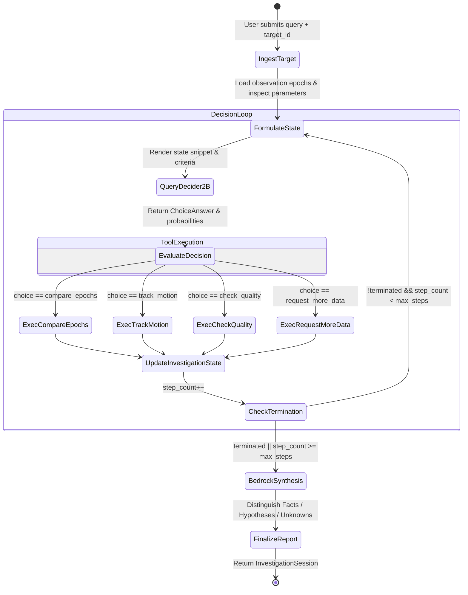

# NEBULA System Architecture
## Autonomous Space Anomaly Investigator

NEBULA is an autonomous astronomical agent system engineered for the **AWS Strands Decider 2B Agent Experience Hackathon 2026**. It decouples discrete agent tool selection from generative synthesis by combining **Strands Decider 2B** (specialized System-One decision routing) with **Amazon Bedrock** (generative reasoning, request decomposition, and structured scientific synthesis).

---

## 1. High-Level System Architecture

```mermaid
flowchart TD
    subgraph UI ["Client Layer (Next.js 14 + Tailwind CSS)"]
        Dashboard["Observation Dashboard & Controls"]
        DecisionLabView["Interactive Decision Lab"]
        BenchmarkView["Head-to-Head Benchmark Suite"]
        TimelineComp["Live Decision & Tool Execution Timeline"]
        ReportCard["Structured Scientific Report Card"]
    end

    subgraph API ["FastAPI Backend (Python 3.12/3.14)"]
        Routes["REST Endpoints (/api/investigate, /api/decide, /api/benchmark)"]
        SpaceAgent["SpaceAnomalyAgent State Machine"]
    end

    subgraph DecisionLayer ["Discrete Decision Layer (System-One)"]
        DeciderClient["Strands Decider 2B Client (tool_selection.py)"]
        LiveDecider["Strands Decider 2B Model (Local / vLLM / Endpoint)"]
        FallbackTriage["Context-Aware Safe Scientific Triage (Fallback)"]
    end

    subgraph ScientificTools ["Specialized Scientific Analysis Tools"]
        ToolA["Compare Epochs (Photometric Delta-mag & Flux Ratio)"]
        ToolB["Track Motion (Astrometric Offset & Proper Motion in arcsec/hr)"]
        ToolC["Check Quality (Bitmask 0x0004 Cosmic Ray & PSF Chi-sq)"]
        ToolD["Request More Data (Gap Analysis & Loop Ceiling)"]
    end

    subgraph GenerativeLayer ["Generative Synthesis Layer (Amazon Bedrock)"]
        BedrockService["Bedrock Service (boto3 Converse API)"]
        ClaudeBedrock["Claude 3.5 Sonnet / Haiku / Nova Pro"]
    end

    subgraph Catalog ["Astronomical Catalog Adapter"]
        ObsService["Observation Service (Deterministic Synthetic & Survey Catalogs)"]
    end

    Dashboard -->|Submit Investigation Query| Routes
    DecisionLabView -->|Evaluate Custom State| Routes
    BenchmarkView -->|Run Labeled Test Cases| Routes
    Routes --> SpaceAgent

    SpaceAgent <--> ObsService
    SpaceAgent -->|1. Formulate ChoiceQuestion| DeciderClient
    DeciderClient -->|HTTP POST SystemOneRequest| LiveDecider
    LiveDecider -.->|Timeout / Error / Low Conf| FallbackTriage
    DeciderClient -->|ToolDecisionResult| SpaceAgent

    SpaceAgent -->|2. Dispatch Action| ScientificTools
    ToolA -->|ToolExecutionFinding| SpaceAgent
    ToolB -->|ToolExecutionFinding| SpaceAgent
    ToolC -->|ToolExecutionFinding| SpaceAgent
    ToolD -->|ToolExecutionFinding| SpaceAgent

    SpaceAgent -->|3. Loop Evaluation (Steps < Max)| SpaceAgent
    SpaceAgent -->|4. Synthesize Report| BedrockService
    BedrockService -->|Structured Prompt| ClaudeBedrock
    ClaudeBedrock -->|ScientificReport| SpaceAgent

    SpaceAgent -->|Complete Session| Routes
    Routes --> TimelineComp
    Routes --> ReportCard
```

---

## 2. Decoupled Cognitive Architecture: System-One vs. Generative

Traditional AI agents rely on a monolithic Large Language Model (LLM) to perform both discrete decision routing (which tool to execute) and generative reasoning (interpreting text and authoring reports). This introduces several critical flaws in mission-critical environments:

1. **High Latency Overhead:** Standard 70B+ parameter generative LLMs require 1,200 ms to 3,500 ms per tool-calling step, creating sluggish agent loops.
2. **Nondeterministic Tool Calling:** Monolithic LLMs can produce hallucinatory arguments, invent unlisted tool names, or switch behaviors unpredictably across slight prompt rephrasings.
3. **Severe Cost Compounding:** Passing accumulating multi-turn agent histories back into large-context LLMs at every decision turn scales token consumption quadratically.

### The NEBULA Architecture
NEBULA solves this by strictly separating the two operational modes:

| Dimension | System-One: Strands Decider 2B | Generative Reasoning: Amazon Bedrock |
| :--- | :--- | :--- |
| **Primary Responsibility** | Discrete next-tool selection from validated action set | Initial query interpretation, context parsing, and final scientific report synthesis |
| **Model Nature** | Specialized 2B parameter decision model | Claude 3.5 Sonnet v2 / Claude 3 Haiku / Amazon Nova Pro via Bedrock |
| **Input Format** | Compact, structured markdown state summary + `ChoiceQuestion` | Rich astronomical findings, light curve metadata, coordinate shifts, and bitmask logs |
| **Output Format** | Discrete `ChoiceAnswer` (exact enum choice + probability distribution) | Structured `ScientificReport` distinguishing facts, physical hypotheses, and unknowns |
| **Target Latency** | **12 ms – 45 ms** (sub-50 ms target) | 800 ms – 1,800 ms (executed once at session conclusion) |
| **Cost Profile** | $\approx \$0.00$ on local edge / \$0.00002 on serverless Fargate | $\approx \$0.003$ per final synthesis |
| **Failure Mode Handling** | Calibrated threshold $\ge 0.65$; fast-fail fallback to safe triage | Graceful degradation to verified template report in development mode |

---

## 3. Investigation State Machine

The investigation lifecycle operates under a strict finite-state contract orchestrated by `backend/app/agent/space_agent.py`:



### Termination Conditions
An investigation halts when any of the following occur:
1. **Tool Self-Termination:** `request_more_data` flags `can_continue=False` because sufficient diagnostic observations have been accumulated or missing epochs prevent further analysis.
2. **Hypothesis Resolution:** Both astrometric motion and photometric variability tools have completed, or a fatal detector artifact (e.g., cosmic ray bit `0x0004` + non-Gaussian PSF $\chi^2 > 4.5$) has definitively invalidated the transient signal.
3. **Step Ceiling Guardrail:** The configurable `max_steps` ceiling (default 4) is reached, immediately preventing infinite execution cycles.

---

## 4. Scientific Tools Contract

All tools inherit strict typing and return structured, reproducible astronomical parameters:

### Tool A: `compare_epochs` (`backend/app/tools/compare_epochs.py`)
- **Physics:** Computes differential photometry between reference and current epochs:
  $$\Delta m = m_{\text{curr}} - m_{\text{ref}}$$
  $$\text{Flux Ratio} = 10^{-0.4 \cdot \Delta m}$$
  $$\sigma_{\text{significance}} = \frac{|\Delta m|}{\sqrt{\sigma_{\text{curr}}^2 + \sigma_{\text{ref}}^2}}$$
- **Outputs:** `delta_magnitude`, `flux_ratio`, `significance_sigma`, `variability_flag` (`significant_brightening`, `significant_fading`, `stable`).

### Tool B: `track_motion` (`backend/app/tools/track_motion.py`)
- **Physics:** Calculates celestial coordinate displacements and proper motion rate:
  $$\Delta \alpha^* = (\alpha_2 - \alpha_1) \cdot \cos\left(\frac{\delta_1 + \delta_2}{2}\right)$$
  $$\Delta \delta = \delta_2 - \delta_1$$
  $$\Delta \theta = \sqrt{(\Delta \alpha^*)^2 + (\Delta \delta)^2}$$
  $$\mu = \frac{\Delta \theta}{\Delta t} \quad [\text{arcsec/hr}]$$
- **Outputs:** `angular_displacement_arcsec`, `motion_rate_arcsec_hr`, `significance_sigma`, `is_moving` (threshold $\ge 3\sigma$).

### Tool C: `check_quality` (`backend/app/tools/check_quality.py`)
- **Physics:** Bitmask inspection and point spread function (PSF) morphology:
  - Bit `0x0001`: Pixel Saturation
  - Bit `0x0002`: Defective / Dead Pixel
  - Bit `0x0004`: Cosmic Ray Strike
  - Bit `0x0008`: Edge / Bleed Artifact
  - Bit `0x0010`: Cloud / Transmission Attenuation
  - PSF $\chi^2$: Good stellar profile is $\approx 1.0$; cosmic rays typically exhibit $\chi^2 > 3.0$ with zero spatial spread.
- **Outputs:** `quality_flags_detected`, `psf_chi_sq`, `artifact_risk_index` [0.0 - 1.0], `artifact_suspected`.

### Tool D: `request_more_data` (`backend/app/tools/request_more_data.py`)
- **Physics:** Evaluates observational cadence, missing bands, and maximum step thresholds.
- **Outputs:** `can_continue`, `missing_fields`, `recommended_cadence`, `reason`.

---

## 5. Security & Least Privilege

- **No Root Execution:** Docker containers run under unprivileged user `appuser` (UID 10001).
- **Zero Hardcoded Secrets:** AWS authentication relies on the standard IAM credential provider chain (ECS Task Role / App Runner Instance Role / AWS SSO).
- **Least-Privilege IAM Policy:** Confined solely to `bedrock:InvokeModel` and `bedrock:Converse` for the specific configured model ARN, plus CloudWatch log streams.
